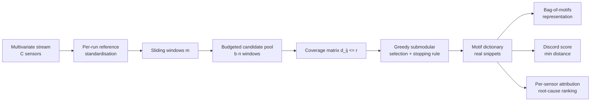
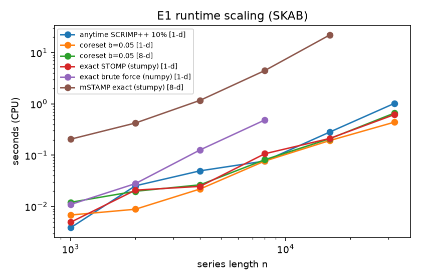
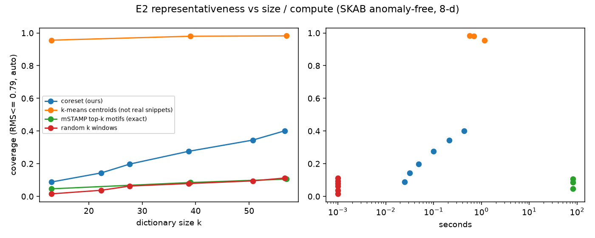
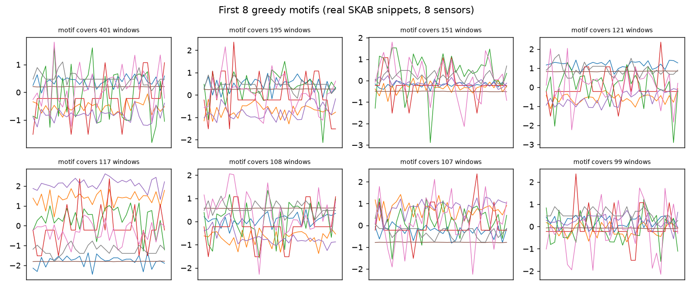
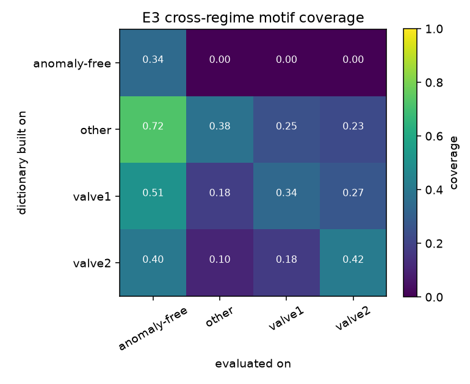
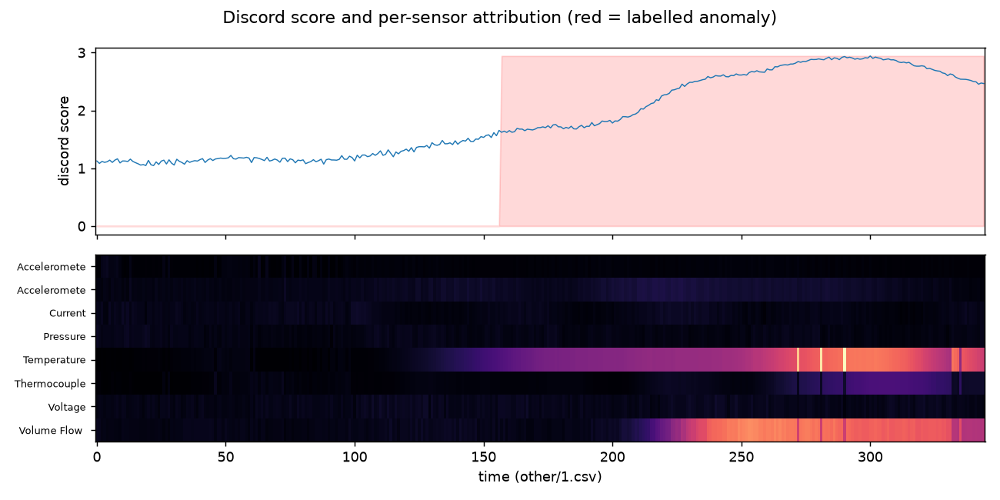
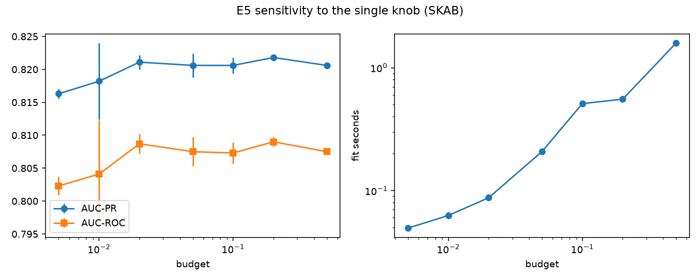

# MotifScale: budgeted coreset motif dictionaries for industrial multivariate time series

Motif mining on industrial sensor streams usually means one of two things: an exact matrix profile,
which is exact but costs O(n²) per dimension, or a heuristic sample of windows that is cheap but
gives no guarantee about how representative the result is. MotifScale treats motif discovery as
**budgeted coverage**. You set one knob, `budget`, and get a small dictionary of *real* sensor
snippets that cover as much of the stream as that compute allows. That dictionary is then the
representation used for anomaly scoring, per-sensor root-cause ranking, and checking how much
behaviour carries over between operating regimes.

Author: **Hossein Tabasi** · License: MIT

## What is in the repo

| Component | File | Notes |
|---|---|---|
| Exact matrix profile (reference) | `src/motifscale/matrix_profile.py::stomp_numpy` | own blocked brute-force, unit-tested against stumpy |
| Exact STOMP / mSTAMP | `stump_exact`, `mstump_profile` | stumpy |
| Anytime approximation | `scrump_anytime` | SCRIMP++ over a fraction of diagonals |
| Matrix-profile discord (AB-join) | `ab_join_discord` | test stream vs normal reference, per channel |
| **Budgeted coreset motif dictionary (new)** | `src/motifscale/coreset.py` | greedy submodular coverage under a compute budget |
| Bag-of-motifs, discord score, per-sensor attribution | `CoresetMotifDictionary.bag_of_motifs/score/channel_attribution` | explainable representation |
| Baselines | `src/motifscale/detectors.py` | Isolation Forest, PCA T²+SPE, exact 1-NN to all reference windows, MP discord |

## Method

Let $w_1,\dots,w_n \in \mathbb{R}^{C\times m}$ be the sliding windows of a standardised $C$-sensor stream, with features
$f_i = \mathrm{vec}(w_i)/\sqrt{Cm}$, so distances are RMS deviations in standard-deviation units.

1. **Budgeted candidate pool.** Draw $n_c=\lceil b\,n\rceil$ candidates $\mathcal{P}$, one per equal-width time stratum.
   Only the distances $d_{ij}=\lVert f_i-f_j\rVert$ for $j\in\mathcal{P}$ are computed, so the cost is $O(b\,n^2 Cm)$.
2. **Coverage objective.** Window $i$ is covered by $j$ if $d_{ij}\le r$. The dictionary maximises
   $$F(S)=\big|\{\,i:\min_{j\in S} d_{ij}\le r\,\}\big|,\qquad S\subseteq\mathcal{P}.$$
   $F$ is monotone submodular, so greedy selection is within $(1-1/e)$ of the best size-$|S|$ dictionary drawn from the pool.
3. **Stopping rule.** Stop when coverage reaches `target_coverage`, when the marginal gain falls below 0.2% of $n$,
   or at `max_motifs`. The radius $r$ defaults to **auto**: the median nearest-neighbour RMS distance in a fixed
   1000-window sample, which is the stream's own noise floor. It does not depend on $b$, so `budget` stays the only knob.
4. **Representation and scores.** Each window is described by its nearest motif and its distance to it.
   A segment becomes a bag-of-motifs histogram. The discord score is $s(w)=\min_{j\in S}d(w,j)$, and the per-sensor
   attribution is $a_c=\lVert w_c-\mu_{j^*,c}\rVert^2$, used to rank root causes.



## Data (real, public)

* **SKAB**, the Skoltech Anomaly Benchmark (https://github.com/waico/SKAB): a water-circulation testbed with 8 sensors at 1 Hz.
  I use 33 labelled runs (valve1, valve2, other). `other/2.csv` is excluded because its anomaly starts at t=104,
  inside the reference prefix. Protocol: the first 400 samples of each run are its normal reference (scaler and
  model fit), and the rest is test. That gives 23,421 test points, of which **54.2% are anomalous**. This base rate is
  high and inflates AUC-PR, so compare methods against each other rather than against other papers.
* **Tennessee Eastman Process**, Braatz-group data (https://github.com/camaramm/tennessee-eastman-profBraatz): 52 variables at a
  3-minute sampling interval. Reference is `d00.dat` (500 normal samples). Test runs are `d01_te`…`d21_te`, with each fault introduced
  after sample 160 (83% anomalous points).

`scripts/download_data.sh` clones both. Only a 60-row format sample is committed (`data/sample/`).

## Quickstart

```bash
pip install -r requirements.txt
bash scripts/download_data.sh            # or export INDUSTRIAL_TS_DATA=/path/with/SKAB_and_TEP_Braatz
pytest -q                                # 10 tests
bash scripts/run_all.sh                  # E1-E5 -> experiments/results, figures, reports/RESULTS.md
```

```python
from motifscale.coreset import CoresetMotifDictionary
d = CoresetMotifDictionary(m=32, budget=0.05).fit(train_array)   # (T, C) standardised
score = d.score(test_array)                                        # discord score per window
why = d.channel_attribution(test_array)                            # (N, C) per-sensor contribution
```

Configuration (`configs/default.yaml`): `budget`, `window`, `window_tep`, `radius: auto`, `seeds`.

## Results

All numbers come from `scripts/run_experiments.py` on an 8-core CPU box that was shared with other jobs, with 2 BLAS threads.
Wall-clock times are noisy because of that sharing, but the ratios are stable. Full tables are in [`reports/RESULTS.md`](reports/RESULTS.md).
Raw CSVs are in `experiments/results/`.

### E1: runtime scaling (SKAB sensors concatenated to length n, m=32)

| n | exact STOMP 1-d | SCRIMP++ 10% 1-d | coreset b=0.05 1-d | mSTAMP exact 8-d | coreset b=0.05 8-d |
|---:|---:|---:|---:|---:|---:|
| 4,000 | 0.025 s | 0.050 s | 0.022 s | 1.17 s | 0.026 s |
| 8,000 | 0.107 s | 0.077 s | 0.077 s | 4.46 s | 0.082 s |
| 16,000 | 0.212 s | 0.281 s | 0.192 s | 21.9 s | 0.209 s |
| 32,000 | 0.617 s | 1.020 s | 0.439 s | not run | 0.660 s |

In one dimension, stumpy's JIT-compiled STOMP is already fast and the coreset is only on par with it. The real gain is
multivariate: at n=16k with 8 sensors, the coreset dictionary takes **~0.21 s versus ~21.9 s** for mSTAMP (about 100×).
At these lengths, SCRIMP++ with 10% of the diagonals was not faster than exact STOMP.



### E2: representativeness vs compute (SKAB anomaly-free run, 8-d, auto radius r=0.79)

| method | k | coverage | recon RMS | seconds |
|---|---:|---:|---:|---:|
| coreset b=0.05 (ours) | 38.7 | **0.276** ± 0.009 | 0.834 | 0.10 |
| coreset b=0.2 (ours) | 56.7 | **0.401** ± 0.002 | 0.813 | 0.44 |
| mSTAMP top-k motifs (exact), k=39 | 39 | 0.085 | 0.882 | 81.7 |
| mSTAMP top-k motifs (exact), k=57 | 57 | 0.106 | 0.868 | 81.7 |
| random k windows, k≈39 | 38.7 | 0.079 | 0.874 | – |
| k-means centroids, k=39 (*averaged, not real snippets*) | 39 | 0.980 | 0.659 | 0.69 |

With the same number of real-snippet motifs, the greedy coverage dictionary covers **3–4× more windows** than the classic
top-k matrix-profile motifs or random windows. Classic top-k motifs are the tightest *pairs*, which is not the same as the
most *representative* windows. K-means centroids cover far more, but they are averages that denoise the signal, not
observed snippets, so they give up the interpretability this project is after. I report them as an upper reference, not a competitor.

 

### E3: motif stability across operating regimes

Cross-coverage, where the dictionary is built on the row group and evaluated on the column group (b=0.1, mean of 3 seeds):

| dictionary from \ evaluated on | anomaly-free | other | valve1 | valve2 |
|---|---:|---:|---:|---:|
| anomaly-free | 0.344 | 0.000 | 0.000 | 0.000 |
| other | 0.724 | 0.376 | 0.248 | 0.227 |
| valve1 | 0.510 | 0.184 | 0.338 | 0.272 |
| valve2 | 0.401 | 0.104 | 0.176 | 0.416 |

Seed stability: 92–96% of motifs from one seed have a match within r in another seed's dictionary on the long anomaly-free run.
That falls to 58–67% on valve2, which has only 4 short reference segments. On TEP, the d00 dictionary covers 0.120 of normal
test prefixes but only 0.009 of faulty segments.

The anomaly-free row is an honest negative. That file is standardised with its own whole-file statistics, so its dictionary does not transfer
to runs standardised with their own 400-sample prefixes. Regime-specific normalisation matters as much as the motifs themselves.



### E4: downstream anomaly detection

Point scores come from causal windows, with metrics pooled over all runs. F1 is reported **both without and with point-adjust (PA)**.
"best" uses the oracle threshold. "ref-thr" uses the 99th percentile of the reference scores, which is a deployable threshold.

| dataset | method | AUC-PR | AUC-ROC | F1 best | F1 best (PA) | F1 ref-thr | score time |
|---|---|---:|---:|---:|---:|---:|---:|
| SKAB | **MotifScale coreset b=0.05 (ours)** | **0.821** ± 0.002 | **0.808** | 0.792 | 0.903 | **0.792** | 0.06 s |
| SKAB | PCA T²+SPE | 0.812 | 0.785 | 0.765 | 0.924 | 0.759 | 0.005 s |
| SKAB | exact 1-NN to all reference windows | 0.810 | 0.796 | **0.795** | 0.882 | 0.703 | 1.16 s |
| SKAB | Isolation Forest | 0.798 ± 0.015 | 0.790 | 0.784 | 0.902 | 0.783 | 0.42 s |
| SKAB | Matrix-profile AB-join discord | 0.617 | 0.576 | 0.703 | **0.961** | – | 36.7 s |
| TEP | **MotifScale coreset (ours)** | 0.985 | 0.922 | 0.925 | 1.000 | 0.887 | 0.08 s |
| TEP | exact 1-NN to all reference windows | **0.985** | **0.926** | **0.926** | 1.000 | **0.909** | 1.03 s |
| TEP | PCA T²+SPE | 0.979 | 0.895 | 0.916 | 1.000 | 0.884 | 0.01 s |
| TEP | Isolation Forest | 0.970 | 0.866 | 0.922 | 1.000 | 0.750 | 0.46 s |

How to read this:

* On SKAB, the coreset dictionary has the best AUC-PR and AUC-ROC, but the lead over PCA and 1-NN is small (+0.009 AUC-PR).
* On TEP, the coreset dictionary matches exact 1-NN within 0.001 AUC-PR while scoring about 13× faster.
* Point-adjust inflates everything. The matrix-profile discord is the *worst* detector on AUC-PR (0.617) and the *best* on PA-F1 (0.961). That is why both numbers are reported.



### E5: sensitivity to the single knob

| budget | motifs k | fit s | AUC-PR | AUC-ROC | F1 best |
|---:|---:|---:|---:|---:|---:|
| 0.005 | 11.7 | 0.05 | 0.816 | 0.802 | 0.788 |
| 0.02 | 27.3 | 0.09 | 0.821 | 0.809 | 0.796 |
| 0.05 | 37.3 | 0.21 | 0.821 | 0.808 | 0.792 |
| 0.2 | 44.0 | 0.55 | 0.822 | 0.809 | 0.794 |
| 0.5 | 48.7 | 1.59 | 0.821 | 0.808 | 0.793 |

Detection quality is flat (0.816–0.822 AUC-PR) across a 100× range of budget, while fit cost grows about 30×.
In practice, a budget of 0.02–0.05 is enough. Coverage keeps rising with budget (see E2), so a larger budget pays off for
*characterisation* (dictionary quality), not for detection.



## Limitations

* The SKAB test portion is 54% anomalous, so AUC-PR is high for every method. Margins between methods are small.
* TEP has only 500 normal reference samples, and the faults are detected by almost any method under PA. Faults 3, 9 and 15 are known to be nearly undetectable.
* The auto radius makes coverage values relative to each stream's noise floor, so they are not comparable across datasets.
* Timings were measured on a shared CPU, and E1 uses single runs.
* There are no root-cause ground-truth labels in SKAB or Braatz TEP, so the per-sensor attribution is illustrated (figure) but not scored here.

## Cite

```bibtex
@software{tabasi2026motifscale,
  author = {Tabasi, Hossein},
  title  = {MotifScale: Budgeted Coreset Motif Dictionaries for Industrial Multivariate Time Series},
  year   = {2026},
  url    = {https://github.com/hosseinTabasi/motifscale-industrial-ts}
}
```

Please also cite the datasets: Katser & Kozitsin, *Skoltech Anomaly Benchmark (SKAB)*, Kaggle/GitHub, 2020; and the Tennessee Eastman
process data distributed by the Braatz group (Chiang, Russell & Braatz, *Fault Detection and Diagnosis in Industrial Systems*, Springer, 2001).
